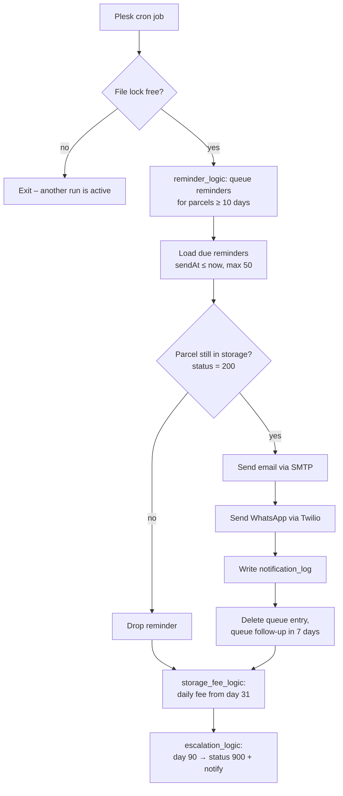
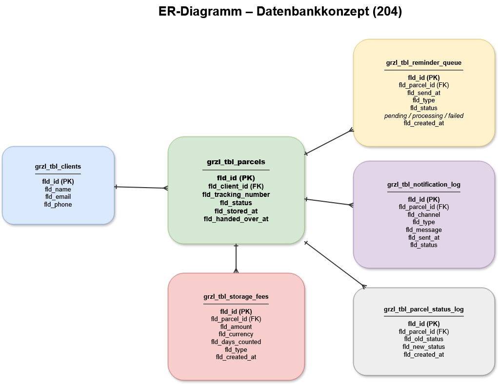

# IPA Final Project: Automated Parcel Reminders & Fee Management

**Grenzlager.ch · Swiss Federal VET Diploma (EFZ) – Application Development · 2026**

For my final practical project (**IPA**, *Individuelle Praktische Arbeit*), I designed and implemented an extension to Grenzlager's warehouse management system. It sends collection reminders by **email and WhatsApp**, calculates **storage fees**, escalates parcels that are **far overdue**, and logs every notification.

> ✅ **Assessed by cantonal examination experts as part of the Swiss vocational qualification process: passed.**

| | |
|---|---|
| **Duration** | 10 working days (30 April – 18 May 2026) |
| **Role** | Sole developer: analysis, planning, database design, implementation, testing, documentation |
| **Method** | IPERKA (Inform → Plan → Decide → Implement → Control → Evaluate) |
| **Stack** | PHP 8.4 · MariaDB · PDO · Twilio API · PHPMailer (SMTP) · Bootstrap · JavaScript · Plesk cron |
| **Host system** | [grenzlager-gmbh](https://github.com/aliassem2812/grenzlager-gmbh), the parcel management app I built for the company |

---

## The problem

Grenzlager receives parcels near the Swiss border for customers whose online shops don't ship to Switzerland. The customers then collect their parcels in person.

Customers were notified **only once**, when the parcel arrived. After that, nothing happened. Uncollected parcels stayed in the warehouse for weeks or months, took up space, and staff had to chase customers and track fees by hand. There was also no record of who had been notified and when.

## The solution

The storage duration now drives the process automatically. A server-side cron job checks every stored parcel and acts on how long it has been in storage:

| Storage time | Action |
|---|---|
| **Day 0** | Parcel logged, arrival notification sent (existing feature) |
| **Day 10** | First reminder by email + WhatsApp |
| **Every 7 days after that** | Follow-up reminder |
| **From day 31** | Daily storage fee (CHF 5 per day) |
| **Day 90** | Escalation: status → *disposal* (900), customer notified on both channels |
| **Parcel collected** | Pending reminders are dropped automatically |

Everything that happens is written to the database and shown in an admin dashboard.

---

## Architecture decision

I compared two approaches before writing any code:

| | Option 1: Process everything directly in the cron job | **Option 2: Reminder queue** ✅ |
|---|---|---|
| Pros | Simpler, fewer tables, faster to build | Full control over processing, no duplicate messages, traceable, easy to extend |
| Cons | Higher risk of duplicate processing, hard to trace, one error can break the whole run | More implementation work, extra table |

I chose **Option 2**. Reminders are first written to a queue table with a due date (`sendAt`). The cron job then only processes entries that are due, up to **50 per run**, which also protects against SMTP rate limits. After a successful send, the entry is deleted and the next reminder is queued.



## Database extension

I extended the existing MariaDB schema with three new tables **without changing any existing table**. Each one references the parcel table with a foreign key and `ON DELETE CASCADE`, so deleting a parcel also removes its reminders, logs and fees.

| Table | Purpose |
|---|---|
| `grzl_tbl_reminder_queue` | Temporary queue of planned reminders (`pending` / `processing` / `failed`) |
| `grzl_tbl_notification_log` | Permanent log of every message: channel, type, recipient, content, status, error |
| `grzl_tbl_storage_fees` | Calculated storage fees per parcel |

Status changes, including escalations, go into the existing `grzl_tbl_parcelStatusLog`.



Full SQL: [`database/ipa_extension.sql`](database/ipa_extension.sql)

---

## Key features

### Protection against duplicates
The task required that running the job several times on the same day must **never** produce a message, fee or escalation twice. This is handled on several levels:
- **File lock (`flock`)**: a second cron instance exits immediately while one is running
- **Queue check**: no new reminder if the parcel already has a `pending` one
- **Per-run memory**: a parcel is processed at most once per run
- **Fee check**: at most one fee per parcel per day (`DATE(createdAt) = CURDATE()`)
- **Escalation check**: skipped if status 900 is already in the parcel's status history

### Two notification channels
- **Email** via PHPMailer over SMTP
- **WhatsApp** via the official **Twilio PHP SDK** (sandbox during the IPA)
- Every attempt, successful or failed, is stored with the error message if there is one

### Admin dashboard (`parcels_overview.php`)
- Lists all active and escalated parcels with customer, status, days in storage and total fees
- Colour cues: orange from 30 days, red from 90 days, red badge for *disposal*
- Shows only the **latest** notification per parcel (subquery with `MAX(sentAt)`, so email and WhatsApp from the same run appear as one entry)
- **Expandable rows** (plain JavaScript, no extra framework) show the full notification history and fee details

### Safe development
I developed the extension on a **separate subdomain with a copy of the database**, so the live system used by customers was never affected and the original stayed available as a backup.

---

## Testing

Time-based logic can't be tested by waiting 90 days, so I **backdated the arrival date** of test parcels in the database to trigger each rule immediately. I tested each module on its own during development and then the complete system through the cron job (switched to run every minute for the final test).

**All 12 test cases passed.** See [`docs/test-plan.md`](docs/test-plan.md).

### Real bugs found and fixed

| Problem | Cause | Fix |
|---|---|---|
| Cron job failed to start | Wrong script path in the Plesk config | Corrected the path to the subfolder |
| Emails not sent | PHP read `SMTP_FROM_EMAIL`, but `.env` defined `FROM_EMAIL` | Matched the variable names |
| Twilio rejected numbers | ISO country code `ch` was put in front of `+41…`, giving `ch+41…` | Use the full stored number and strip spaces → E.164 |
| Cron stopped after the first module | Included logic files called `exit` when nothing was found | Replaced `exit` with `return` |
| WhatsApp "sent" but not received | Twilio sandbox needs each recipient to join first | Configuration, not code: joined the sandbox |
| Escalated parcels didn't notify the customer | The escalation only changed the status | Added email + WhatsApp + logging to the escalation |
| Escalated parcels missing from the dashboard | Query filtered only `status = 200` | Changed to `IN (200, 900)` and added a red badge |
| Fee rule also matched archived parcels | `status != 300` was too broad | Changed to an explicit `status = 200` |

---

## Project management

The IPA followed **IPERKA**, with a timetable in hour blocks, a daily work journal (planned vs. actual) and meetings with the experts:

| Phase | What I did |
|---|---|
| **Inform** | Analysed the assignment, clarified open questions with my supervisor, drew the process flow |
| **Plan** | Timetable, system concept, ER diagram, test concept |
| **Decide** | Chose the project method and compared two architecture options (queue vs. direct) |
| **Implement** | DB extension, test environment, logging, cron job, reminders, WhatsApp, email, fees, escalation, dashboard |
| **Control** | Defined test cases, ran module and full-system tests, analysed and fixed bugs |
| **Evaluate** | Reflection, project assessment, suggestions for improvement |

## Repository structure

```
src/
├── cron_reminder.php          # Orchestrator: runs all steps in order
├── reminder_logic.php         # Fills the reminder queue (10 days / every 7 days)
├── storage_fee_logic.php      # Daily storage fee from day 31
├── escalation_logic.php       # Day 90: status 900, status log, notify customer
├── parcels_overview.php       # Admin dashboard with expandable details
├── parcels_overview.css       # Dashboard styles
├── notification_log_insert.php# Logging prototype (development step)
├── whatsapp_send.php          # Twilio WhatsApp test (development step)
└── emailipa_send.php          # SMTP test (development step)
database/
└── ipa_extension.sql          # CREATE TABLE statements for the 3 new tables
docs/
├── er-diagram.png
└── test-plan.md
```

> These files are an **extension** of the host application. They depend on its `config/bootstrap.php` (Composer autoload, `.env`, PDO connection `Grenzlager\Util\Db`), the `Auth` middleware and the existing parcel and client tables. Credentials go in `.env`; see [`.env.example`](.env.example). Code comments are in German, as written during the exam.

---

## What I learned

- Building **time-driven server processes** with cron and making them safe to run again
- Integrating an **external API** (Twilio) and debugging problems that turn out to be configuration, not code
- **Data modelling** for histories, queues and logs
- Why **logging** matters: it made almost every bug above quick to find
- Planning, documenting and delivering a complete project to a deadline, alone

## After the IPA

The extension is now part of the production system. For live use I added safeguards beyond the exam scope: configurable batch sizes, a cut-off date that keeps imported legacy parcels out of the automation, feature flags for WhatsApp and escalation, and a weekly instead of daily fee model. See the [main project](https://github.com/aliassem2812/grenzlager-gmbh).
